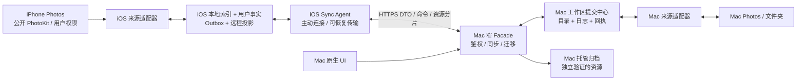
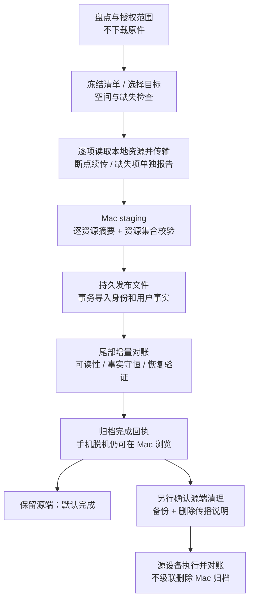

# ADR-102：双端本地图库、整理信息同步与 iPhone 向 Mac 完整迁移

> 状态：**提案 / 产品架构规划，待评审；S0–S3 部分实施**。进度与验收边界见 [实施状态](ADR-102-IMPLEMENTATION-STATUS.md)。<br>
> 日期：2026-09-24<br>
> 输入：所有者要求 iPhone 与 Mac 各自处理本地照片、远程处理对方照片，并能把手机照片及整理成果完整迁入 Mac。<br>
> 本次交付：资料调研、现状核对、范围与架构决策建议、实施阶段和验收门。本文不授权实际读取、上传或删除用户照片。<br>
> 适用拓扑：单所有者、一个指定 Mac、首轮一个配对 iPhone；按两端独立的本地相册设计，不要求 Apple Account 或 iCloud。<br>
> 最新范围收敛：所有者明确“暂时不考虑 iCloud，就当成各端本地相册”。本期不实现云标识映射、云下载、云同步或云迁出；相关平台风险仅作来源适配边界。<br>
> 不扩展：多 Mac Host、多租户、运营方不可见内容、应用层端到端加密；这些必须另开 R4B ADR。

## 1. 结论与决策摘要

原生 iOS 从“只操作 Mac 的 Companion”扩展为“能独立整理本机照片、连接一个 Mac 的照片整理客户端”。这确实超出旧 Companion 的数据边界，不能只增加几个远程接口后宣称完成双端同步。

建议采用 **本地可用、Mac 汇总、按来源执行、媒体按需传输** 的架构：

1. **两端各有本地能力。** iPhone 通过公开 PhotoKit 访问已授权的本机图库；Mac 继续管理 Mac Photos、文件夹和托管导入目录。手机未配对或 Mac 离线时，仍能浏览、收藏、打标签和保存本地整理结果。
2. **共享工作区只有一个最终提交中心。** 指定 Mac 保存共享元数据的正式版本、操作回执和同步日志。iPhone 的本地用户事实是持久数据；尚未提交到共享工作区的改变明确标为待同步，不是可丢弃缓存。两端不互拷 SQLite，不维护可任意互相覆盖的两份主库。
3. **源端权限不转移。** 谁能够合法访问某个文件夹或 PhotoKit 资产，谁执行实际读取、收藏写回、回收等来源操作。Mac 的共享元数据权威不等于它能直接访问手机 PhotoKit。
4. **同步分成三条独立流程。** 整理信息同步、媒体传输、源端处置分别有状态和完成条件。同步收藏成功不意味着原件已备份；原件复制成功不意味着相册和标签已导入；迁移成功不自动删除手机照片。
5. **Mac 远程处理手机以手机主动连接为前提。** iPhone 主动上传所选来源的目录投影，并领取 Mac 下发的窄命令；不在 iPhone 开公网 HTTP Host，不承诺手机被杀进程后仍可随时远程浏览原件或执行删除。
6. **完整迁移默认落到 Mac 的独立托管文件目录。** 保留媒体资源、可用版本、整理事实和相册成员关系；以实际资源校验与入库回执证明完成，不能只看 Mac 列表中出现了照片。
7. **删除不作为同步冲突的解决方式。** 权限收缩、设备离线、共享范围缩小、目录项消失都不能自动触发另一端原件删除。删除必须是单独的、明确指向具体存储实例的操作。

首轮不实现无中心的通用双主同步。媒体读取采用 local-only 策略；某项原始资源不在设备本地时，报告“不在本机，暂不支持迁移”，保留已有整理信息，不请求下载。两端本地资料如何汇合是主问题，不引入云服务账户和云端副本管理。

## 2. 现状、复用基础与需要修订的边界

### 2.1 本次代码现场

只读核对基线为 `main@810a3989c7f6c8a8481c789ced7415858445057d`。主工作树存在其他会话的 OpenMontage / 时光故事等未提交修改，本文不处理它们。

旧产品化 worktree 已不在 `git worktree list`，但分支 `lgw/imageall-companion-productization@c441d048078de4ba64e3b0517c1753d7319195da` 保留；P0–P8 原生 iOS 改进尚未进入该主线。此基线必须在实施时重新核对，不能把留档测试结果当作当前组合的验证。

已有基础：

| 现有能力 | 可复用部分 | 尚不能据此宣称具备的能力 |
|---|---|---|
| Remote Protocol / Client / Facade | 配对、鉴权、DTO、幂等命令、查询、事件、远程写操作 | 持久增量同步日志、iPhone 本地图库和双端冲突处理 |
| 稳定 `Asset.id`、来源和内容 revision | 保留人工事实、失效派生结果 | 跨设备身份、一个逻辑媒体的多个存储实例 |
| Mac Photos Adapter | PhotoKit 元数据、变化历史、媒体请求、收藏写回 | 可直接链接到 iOS 的独立模块；现有权限枚举尚未表达 `.limited` |
| 红心状态模型 | 目标值、来源观测、待写回意图、旧 revision 防覆盖 | 多端离线冲突和多个本地副本的写回范围 |
| PortableCatalogExporter | 版本化清单、用户事实导出、文件摘要 | 完整媒体迁移包、双端导入与恢复协议 |
| Photos Exit Bridge | 全部公开资源导出、哈希、身份关联、事实守恒思路 | 运行中双端增量合并；工具的数据库快照切换不能直接用于手机同步 |
| Mac 瘦身 / 回收 | 来源安全校验、收藏硬保护、操作进度 | 手机来源的处置、跨设备保留副本与备份用途判断 |

代码依据：

- [`Asset.swift`](../ImageAll/Domain/Models/Asset.swift)、[`Source.swift`](../ImageAll/Domain/Models/Source.swift)。
- [`PhotosLibraryContracts.swift`](../ImageAll/Application/Photos/PhotosLibraryContracts.swift)。
- [`RemoteCatalogFacade.swift`](../ImageAll/Application/Remote/RemoteCatalogFacade.swift)。
- [`RemoteHTTPServer.swift`](../ImageAll/Infrastructure/Remote/RemoteHTTPServer.swift)：当前请求总上限为 256 KiB，并先缓冲请求；它不是现成的大文件上传服务。
- [`PortableCatalogExporter.swift`](../ImageAll/Infrastructure/Export/PortableCatalogExporter.swift)。
- [`Photos Exit Bridge`](../tools/photos_exit_bridge/README.md)。

### 2.2 与已有 ADR 的关系

| 权威文件 | 本提案的影响 |
|---|---|
| [ADR-043-MAC-HOST-IOS-COMPANION.md](ADR-043-MAC-HOST-IOS-COMPANION.md) | 提议把“Mac 是一切写入的唯一权威”细化为“Mac 是共享工作区提交中心，来源设备是物理操作执行者”；允许 iPhone 独立持久化本地事实。禁止数据库文件同步、禁止 UI Model 成为网络入口的要求保留 |
| [docs/ADR-044-MAC-HOST-COMPANION-R3.md](ADR-044-MAC-HOST-COMPANION-R3.md) | 配对、设备撤销、TLS、幂等继续使用；新增同步范围与能力协商，不复用列表分页 cursor 充当同步 cursor |
| [ADR-047-MAC-HOST-CLOUDFLARE-PUBLIC-TUNNEL.md](ADR-047-MAC-HOST-CLOUDFLARE-PUBLIC-TUNNEL.md) | 仍为单所有者、单 Mac 的 R4A。Cloudflare 是可见应用层的受信任 TLS 终止方；大文件传输仍在此信任模型内，不宣称 E2E |
| [ADR-055-ASSET-FAVORITES-AND-PHOTOS-SYNC.md](ADR-055-ASSET-FAVORITES-AND-PHOTOS-SYNC.md) | 保留收藏独立事实、来源回读和硬保护；扩展前须明确跨设备字段冲突，不能将 Mac 的单机 pending 优先策略直接复制为两个互相竞争的写者 |
| [ADR-060-PHOTOS-EXIT-IDENTITY-MIGRATION-BRIDGE.md](ADR-060-PHOTOS-EXIT-IDENTITY-MIGRATION-BRIDGE.md) | 复用保全资源与事实的原则；新增产品内迁移服务，不运行该独立工具去覆盖在线数据库 |
| [ADR-044-LIBRARY-SLIMMING-AND-RECYCLE.md](ADR-044-LIBRARY-SLIMMING-AND-RECYCLE.md) | 手机首版仅暴露允许的回收动作；不能把 Mac 的永久删除入口直接投影到 iPhone |

**本文是待评审提案，不自动废止上述已批准契约。** 获批后在第一个实现切片补充明确的替代条款和兼容门；旧 Companion 模式仍按旧契约工作。手机是来源代理和客户端，不是第二个可独立承载共享工作区的 Host。如果要求两个设备各自成为共享主库、任意多个 Mac 或中继方不可读，停止本路线并先完成 R4B 决策。

需要纠正此前讨论中的两个简化说法：收藏资产的活动来源删除保护按 ADR-055 是硬保护，不能靠再点一次确认绕过；Apple Photos 的“最近删除”也不能承诺由 ImageAll 直接恢复，必须保留系统 Photos 的操作边界。

## 3. 产品范围与界面契约

### 3.1 核心用途

三个工作区不变：**图库、审核、清理**。跨端同步和迁移服务于这些用途，不再增加一套复杂的“云盘产品”。

图库顶部增加范围切换：

- **此 iPhone**：本机已授权的 Photos 资产，以及以后显式导入的 App 自有媒体。
- **Mac 图库**：Mac 已公开的来源；按需加载媒体，不把整个 Mac 图库复制到手机。
- **全部已连接**：可选的合并视图；只合并已经证明为同一逻辑项的记录，清楚显示副本位置。

Mac 对应显示“本机来源”和“来自 iPhone 的共享来源”。手机来源离线时可查看最后同步的目录和已共享预览，但必须显示更新时间与离线状态；没有预览时显示占位，不暗中转为上传全部照片。

来源图标区分“本机”“远程”“已有 Mac 归档”，同时显示资源“可读 / 不在本机 / 未核验”。本期主路径假设媒体实际存在于来源设备；如果 Photos 返回资源不在本机，按不支持项处理，不能用预览冒充原件。不通过私有 API 探测，也不为了显示状态批量读取全部原件。

### 3.2 用户授权与共享选择

1. 初次启动可继续只连接 Mac，不强制申请手机照片权限。
2. 用户进入“此 iPhone”时解释并申请 PhotoKit 权限；有限访问仍能浏览和整理获准资产。
3. 本机访问权限与跨端分享权限分开。配对不默认上传本机目录、GPS、标签、预览或原件。
4. 用户选择分享整个可访问范围、指定 ImageAll 集合或明确选中项；若依赖 Apple 用户相册，先检查当前权限是否允许枚举相册。
5. 共享策略分级为：目录及整理信息、按需预览、明确传输原件。显示预计项目数、位置数据选项和网络策略。
6. 隐藏资产、共享图库、共享相册及其他敏感/权限复杂来源首轮默认不纳入自动共享或清理，后续以公开 API 能力和单独验收扩展。

### 3.3 同步状态不能压成一个绿勾

用户层保留三个可展开状态：

| 状态 | 完成判据 | 不代表 |
|---|---|---|
| 整理信息已同步 | 本地操作已获 Mac 回执，当前授权范围的元数据拉取已到已知水位，无未解决冲突 | 原件已复制或源 Photos 已写回 |
| 原件已归档至 Mac | 所需资源已持久化、逐项验证，Mac 入库回执可复查 | 手机已删除、已有第二份备份 |
| 来源操作已完成 | 指定来源适配器执行并确认，或明确进入等待来源对账 | 其他副本已被同步删除、磁盘空间已立即释放 |

同步详情提供：最后成功时间、共享范围、待发送/待接收数量、冲突、权限阻塞、媒体传输进度和安全错误码。内部的来源扫描水位、操作 ACK、元数据 cursor、媒体 receipt 分开持久化。

## 4. 平台事实及其产品影响

以下为调研得到的平台约束；后续架构选择是本项目的设计判断。

### 4.1 PhotoKit 身份与授权

`PHObject.localIdentifier` 仅在本地图库上下文中有效，不能直接作为跨设备主键。**本期只使用带来源/设备命名空间的本地 locator、ImageAll ID 和迁移关联清单，不调用 `PHCloudIdentifier` 建立身份。** Apple 的跨设备标识说明用于佐证本地 ID 的作用域，不作为本方案的依赖。[Apple：PHCloudIdentifier 的本地标识说明](https://developer.apple.com/documentation/photos/phcloudidentifier)

有限照片访问只暴露用户选择的资产；Apple 文档明确该模式不能创建或读取用户相册。因此有限授权下显示“已授权照片”，不承诺同步完整系统相册树。权限缩小造成不可见不能当成删除。[Apple：有限图库访问](https://developer.apple.com/documentation/photokit/delivering-an-enhanced-privacy-experience-in-your-photos-app)

PhotoKit 持久变化 token 属于当前设备，可能过期或无法提供变化详情。它适合驱动本机来源索引，不能发送给另一设备作为共同同步进度。失效时需要受限范围重新对账。[Apple：PhotoKit change history](https://developer.apple.com/videos/play/wwdc2022/10132/)

### 4.2 原件、版本和资源

一个 PHAsset 可能包含多个资源：Live Photo 的照片与视频、RAW/JPEG、编辑前后资源和调整数据。迁移不能用“一张缩略图或一个 JPEG”代替逻辑资产的完整资源集合。[Apple：PHAssetResource](https://developer.apple.com/documentation/photos/phassetresource)

PhotoKit 资源读取显式设置 `PHAssetResourceRequestOptions.isNetworkAccessAllowed = false`，其他图片/视频请求同样禁止网络获取。原始资源不在本地时返回缺失/不支持项；本期不提供“允许云下载”分支，也不要求先接入云能力才能迁移其余本地照片。[Apple：资源网络访问](https://developer.apple.com/documentation/photos/phassetresourcerequestoptions/isnetworkaccessallowed)

Mac Photos 的“导出未修改的原片”与“导出当前效果”是不同操作；Live Photo 原片导出包含照片与视频，Photos UI 也提供 IPTC/XMP 导出。这些是系统 App 的能力证据，**不证明 iOS PhotoKit 对所有标题、关键词、人物、编辑参数提供对等 API**。[Apple：导出照片和视频](https://support.apple.com/guide/photos/export-photos-videos-slideshows-and-memories-pht6e157c5f/mac)

### 4.3 只保留一条外部删除边界

本期不建模 iCloud 同步关系、不检测账户、不实现云迁出。但通过 PhotoKit 删除并没有“仅删除此设备磁盘副本”的保证；若用户在系统外部启用了云同步，Photos 删除可能传播。因此来源适配器必须准确描述“从 Photos 删除”，不能写“仅释放本机副本”。开发验收采用明确独立、可丢弃的本地测试图库，不把云端拓扑列为本期功能验收矩阵。[Apple：Photos 删除传播说明](https://support.apple.com/guide/photos/delete-photos-from-icloud-phtda347cde8/mac)

### 4.4 iOS 后台与远程可达性

后台 URLSession 可由系统执行传输，但常规后台上传要求文件输入；用户从多任务界面强制退出 App 会取消该类后台传输，直到重新打开。它不能让任意业务逻辑、WebSocket 或 PhotoKit 命令持续常驻。[Apple：后台传输](https://developer.apple.com/documentation/foundation/downloading-files-in-the-background)、[Apple：background(withIdentifier:)](https://developer.apple.com/documentation/foundation/urlsessionconfiguration/background(withidentifier:))

Apple 另有 PhotoKit 后台资源上传扩展；本机 SDK 暴露 iOS 26.1 接口，网页还描述了更高版本接口。它涉及完整图库权限、资源准备和专门上传协议，**不纳入本期本地相册基线**，也不能当作手机常驻服务器。[Apple：Uploading asset resources in the background](https://developer.apple.com/documentation/photokit/uploading-asset-resources-in-the-background)

本提案基线只承诺**前台会话可完成、任何中断可恢复**。后台扩展是独立优化项，必须先验证 OS 可用性、鉴权更新、私有 Mac 域名配置、代理协议和正常系统调度。它不成为首次可用版本的前置条件。

### 4.5 公网传输

Cloudflare 对请求体大小和代理超时有约束，且额度随套餐与配置变化。不能把一个大视频或整个迁移包作为单次 POST，也不能用一个长请求等待整个批次校验完成。[Cloudflare：413](https://developers.cloudflare.com/support/troubleshooting/http-status-codes/4xx-client-error/error-413/)、[Cloudflare：连接限制](https://developers.cloudflare.com/fundamentals/reference/connection-limits/)

初始传输采用有限分片和异步完成回执，实际限额经 capabilities 协商。不要为迁移而关闭 Cloudflare 代理、开放路由器端口或改动 VPN。公开路由仍遵守 R4A，所有私有 DTO 和媒体响应继续 `no-store`。

## 5. 术语与数据模型

“相册”“照片”“副本”必须分开建模，否则共享、去重和迁移会互相破坏。

| 概念 | 定义与标识建议 | 关键约束 |
|---|---|---|
| Workspace | 单所有者的 ImageAll 共享工作区，`workspaceID` | 一个指定 Mac 协调；不依赖云账户 |
| Device | 已配对设备，`deviceID` + 本次安装身份 | 重装或重新注册不复用旧设备计数器；备份恢复需要核验 |
| Source | 某设备提供的一个 Photos/文件夹/托管归档来源 | `ownerDeviceID`、权限范围和 `sourceEpoch`；不暴露远程绝对路径或 bookmark |
| MediaItem | ImageAll 逻辑媒体，跨端稳定 `mediaID` | 可在多处存在；没有字节也可保留标签与历史 |
| AssetBinding | `mediaID` 与现有 `(catalogID, assetID)` 的绑定 | 兼容原 Mac Asset；不一次重写全部旧主键 |
| Replica | 一个来源中的存储实例，`replicaID` | 权限、是否可读、归档验证、回收生命周期按实例记录 |
| Resource | 一个媒体版本中的具体字节资源 | `resourceID`、role、UTType、字节数、SHA-256、版本；不能仅按文件名匹配 |
| NativeAlbum | 来源端系统相册或文件夹层级的观测投影 | 来源命名空间内唯一；只读观察，不自动向另一端 Photos 写相册 |
| Collection | ImageAll 自己的跨端集合/相册 | 成员引用 `mediaID`，不拥有媒体字节，不与标签混为一谈 |
| UserFact | 标签决定、收藏、集合成员、审核决定等人工事实 | 独立于副本位置、派生缓存和模型版本 |
| Operation / Receipt | 一次用户意图及处理回执 | 稳定操作 ID、负载摘要、版本条件；用于重试、审计与撤销 |

### 5.1 身份建立与关联

首轮采用 UUID + 原点命名空间建立全局身份：手机离线可创建媒体和标签 ID；配对提交时通过持久 alias 表映射到工作区正式 ID。不能先创建 Mac 临时资产，再靠名字猜标签属于哪张图。

关联证据从强到弱：

1. 同一 ImageAll 导出/迁移清单中的稳定 ID 和来源签收关系。
2. 在来源未变更、epoch 一致时，已经登记并回执的跨端 AssetBinding；本地 locator 不能跨来源直接比较。
3. 资源集的角色、大小、原始字节摘要和版本相符：证明字节关系，但不自动证明两条资产的用户意图相同。
4. 文件名、拍摄时间、尺寸、感知相似度：只生成候选，不自动合并身份。

不做云标识自动匹配。两端各自导入过同一文件时，先显示两个来源实例或待关联候选；用户确认逻辑关联后才共享人工事实，不能因画面相同就静默合并标签。

两个字节相同、标签不同的用户资产可以保持两个 MediaItem，只共享底层不可变 blob。**存储去重不等于逻辑合并，更不等于删除许可。** 手动合并需要保留别名和冲突记录；拆分也要可追溯。

现有 Mac `asset_id` 保留，新增映射与资源附表逐步接入；已批准 migration 不改写。Source 重建、换图库、重装设备产生新 epoch，不将旧 locator 静默指向新对象。

首批 iPhone 归档入库时，`mediaID`、手机安装身份和来源 epoch 建立 MediaItem，已验证的 Mac 独立副本建立 Replica。若当前没有已签收的 Mac `Asset` 对应关系，AssetBinding 保持为空；不为凑齐绑定而新建可被普通来源扫描误认为另一张照片的占位 Asset。日后关联已有 Mac Asset 必须有同一迁移链的身份凭据或用户明确确认，单独的字节摘要相同只提供候选。

用户确认关联时先核对双方稳定 ID、Mac 来源、定位信息、媒体类型和内容 revision，事务提交前重新读取；候选变化或 Mac Asset 已绑定其他 MediaItem 则拒绝。AssetBinding 只证明用户确认的身份关系，不在提交时覆盖任一端现有 UserFact。两端人工事实的共享须另经版本与冲突对账后生效；在该能力完成前，界面明确显示关联已记录但整理信息仍独立。错误关联通过二次确认的解除操作纠正；确认与解除追加不可变事件，并以确认事件 ID 阻止旧窗口撤销后来重新确认的绑定，不通过删除媒体或重建来源隐式处理。

### 5.2 三种相册不能互相覆盖

- Apple 用户相册：同步可访问的名称、层级、成员和可获得的排序观测；智能相册只能作为动态来源视图或显式快照，不能伪装成可移植规则。
- Mac 文件夹：同步相对层级投影；手机改 ImageAll 集合不重命名或移动 Mac 文件夹。
- ImageAll 集合：两端均可建立和修改，通过元数据协议同步；迁移时保持成员关系，多相册引用同一媒体不复制 N 份字节。

首轮系统相册只读，ImageAll 集合可写。用户若要求两端原生 Photos 相册也能双向增删改，需要另加来源级写回契约，不能把它藏在“同步全部信息”开关中。

## 6. 架构与权威划分



图中的网络边在公网部署经过 Cloudflare Tunnel；没有新增手机公网入口。Mac 原生业务仍可调用现有应用服务，同步服务挂在业务事务边界，不要求把全部 UI 调用绕一圈 HTTP。

### 6.1 按数据类型决定权威

| 数据 | 原始事实/提交权威 | 双端处理规则 |
|---|---|---|
| Mac 文件与 Mac Photos 当前状态 | Mac 来源 Adapter | 手机提交窄命令，Mac 校验和执行 |
| iPhone Photos 当前状态 | iPhone 来源 Adapter / 系统 Photos | Mac 保存已授权投影；物理写入在手机执行并回执 |
| 手机尚未分享的标签、收藏目标、集合 | iPhone 本地持久库 | 不出设备；首次分享时显式导入所需事实 |
| 工作区共享标签、集合、决定 | Mac 版本化提交中心 | 手机离线记录意图；联网冲突检测后接纳，不按手机时钟覆盖 |
| 系统收藏观测 | 对应来源 Adapter | 与 ImageAll 收藏目标分开；只有来源回读才称写回成功 |
| 原件/编辑资源 | 所在 Replica | 复制建立新的 Replica；不会自动转移或删除旧实例 |
| 审核建议 | 生成者 + 算法/模型/内容版本 | 可重新生成；人工决定单独保存，不能被新推理覆盖 |
| 任务进度、权限、设备可达性 | 执行设备 | 有时间与有效性，不把离线快照当作实时状态 |
| 缩略图、embedding、索引缓存 | 各端可重建产物 | 按内容版本复用/重建，不做全部双向同步 |
| 模型、工程、密钥、bookmark | 其原有设备/服务 | 不属于首版照片整理同步；凭据和书签绝不传递 |

### 6.2 本地与远程能力

- iPhone 本地浏览、标签和集合操作无需 Mac 在线。本机收藏可由本机 Adapter 写回；共享事实仍有独立提交状态。
- Mac 离线时对 Mac 资产可查看已有缓存；仅允许离线排队明确可重放的标签/收藏/集合意图。审核依赖有效建议和内容版本，失效必须回到待确认。
- 远程删除、原生相册写入等不进入普通离线自动队列；等待用户在线确认。资源不在本机时本期不执行下载补全。
- Mac 请求手机媒体时，如果已有授权预览/归档即可使用；否则写入限时读取请求，由手机下次活动连接领取。UI 显示“等待 iPhone 打开 ImageAll”。
- Mac 对共享手机媒体的 ImageAll 标签可以在 Mac 立即提交；手机下次同步接收。需要 PhotoKit 执行的收藏或删除另有来源操作状态，不能混称完成。
- 手机本地 AI 首轮不承诺全套 Mac 模型。先复用人工整理能力；可在明确授权预览传输后由 Mac 生成手机资产建议，结果绑定资源 revision。设备端轻量推理以后单独评估。

### 6.3 来源命令有独立生命周期

远程来源命令采用 `queued → claimed → awaitingLocalConfirmation → executing → succeeded / failed / expired / outcomeUnknown`。只读请求或已授权收藏写回可以跳过人工确认阶段；删除不可跳过。每条命令绑定目标设备注册 epoch、source epoch、scope revision、资产/资源 revision、命令 ID 和有效期。

手机领取使用有期限的 lease，但 lease 超时不意味着物理操作没有发生。执行端先持久化意图，再调用来源 API，再记录回读结果；若调用成功后进程退出但尚未回执，重新连接先核验来源和本地 journal，不盲目重复删除或导入。无法确定结果时进入 `outcomeUnknown`，由来源对账或人工处理。

用户取消、权限撤回、设备撤销或命令过期后，不再开始新副作用；已经发生的来源写入不能保证撤销。延迟到达的旧回执只更新该命令历史，不能覆盖新收藏目标或新资源版本。修改元数据所产生的来源观察还需关联因果操作，避免自身写回事件反复生成新的同步意图。

## 7. 整理信息同步协议

### 7.1 不复制数据库，传递领域记录与意图

iOS 可使用独立本地数据库保存本地事实、同步日志和缓存投影；这不等于同步 Mac SQLite。禁止发送 SQLite/WAL、同步数据库所在目录、让 iCloud Drive 复制活动库，或由网络命令执行 SQL。

协议版本与 capability 至少区分：`localSources`、`metadataSync`、`collections`、`mediaTransfer`、`migrationReceipts`、`sourceCommands`。旧 Host 不声明能力时保持纯 Companion 模式，不清除手机本地事实。

建议协议面（名称为设计草案，不表示现有接口）：

| 操作 | 作用 |
|---|---|
| 建立同步 scope | 绑定工作区、设备、授权来源、共享策略与 epoch |
| snapshot + watermark | 返回一致的范围快照和其对应的日志水位 |
| changes(afterCursor) | 分页拉取该 scope 的后续改变和 tombstone |
| submitOperations | 提交业务意图，返回 applied / conflict / rejected 和正式 revision |
| acknowledge | 确认本地已事务性落地的 cursor，辅助日志保留 |
| claimSourceCommands / reportResult | 手机领取限时来源命令、报告执行状态 |

列表分页 cursor、PhotoKit change token、同步日志 cursor 是三种不同概念，不得混用。

### 7.2 可靠性要求

1. 本地业务改变与 Outbox 记录同事务；掉电后可继续发送。远程投影与本地待提交覆盖层分开保存。
2. 操作至少包含 `workspaceID`、设备注册 epoch、`operationID`、设备内单调序号、实体/字段 base revision、依赖操作和负载摘要。墙钟时间只展示，不裁决胜负。
3. Mac 在同一事务完成权限校验、业务更新、幂等回执和变更日志。幂等主键相同且摘要不同返回冲突；ACK 丢失后重试返回原结果。
4. 快照必须绑定一致水位；分页期间发生的新变化由该水位之后的日志补齐。服务端明确快照有效期，失效重新获取，不混拼多个时间点。
5. iPhone 原子应用一页变化并推进 cursor。重复页、乱序通知和重连不重复写用户事实。
6. WebSocket 只通知“可能有新变化”，不承担完整可靠日志；断线后按持久 cursor 补拉。
7. 用户主动断开停止网络活动、重连和新命令领取；不删除本地工作。重新连接核验 Host/workspace 身份后恢复。
8. 撤销是引用原操作并检查当前 revision 的新业务操作；若别人已改同一字段，不能用历史 undo 快照覆盖新决定。
9. 日志和幂等记录不能无限增长。初期设计目标为 30 天离线窗口、至少 90 天日志/回执保留，具体容量在首个同步切片测量后冻结；这不是现有服务承诺。过期返回 `resetRequired`，保留本地 Outbox，先查询旧操作结果/人工复核再重提交，不能丢掉或生成新 ID 盲重放。
10. 设备长期离线后的 tombstone 通过快照 epoch 处理。服务端永久拒绝已撤销设备旧注册身份的操作，不因日志压缩复活已删除标签或来源。

同步日志在服务端按设备授权 scope 过滤，客户端不能通过 cursor 推测未共享资产明细。共享范围变更推进 scope revision，旧快照失效；只能下发此前允许的对象撤回信息，不把其他私有来源补进重置快照。离线操作只能针对本地可见且被授权的实体；服务端重新鉴权，设备序号不能替代权限检查。

Mac 从备份恢复时必须推进工作区恢复 epoch；旧 cursor 和已过期回执不能继续使用。先进入恢复对账流程，保留客户端未同步事实，暂停来源破坏性操作，重新确认哪些操作已生效。

### 7.3 冲突规则

首版使用按字段版本检查和明确冲突项，不实现通用 CRDT，也不简单采用最后写入覆盖。

| 冲突情形 | 规则 |
|---|---|
| 两端改不同标签 | 分别合并，不以资产整行 revision 相互阻塞 |
| 同一资产同一标签：接受 vs 拒绝/清除 | 返回冲突，保存两个意图；用户选择后以新 revision 提交。清除是明确操作，不等于缺失字段 |
| 同一字段写成相同值 | 可归并为无变化成功，但保留对应回执 |
| 两端新建同名标签 | 由 Mac 按既有名称规则确定正式 ID，返回 alias；只有分组和含义一致才自动归并，否则保留待决，不静默混标签 |
| 标签重命名/归档与离线应用交叉 | 以稳定 ID 关联；已归档标签的迟到应用待确认，不靠旧名字重建标签 |
| 集合不同成员的增删 | 按成员独立合并；同成员相反操作或并发重排使用版本冲突；不能用全量数组覆盖对端新增成员 |
| 收藏相反意图 | 保存目标和来源观测，显式冲突；任一相关有效收藏/未决收藏为 true 时，清理保守保护 |
| PhotoKit 外部收藏变化与未完成意图 | 保留观测与待写回目标；单设备沿用 ADR-055。对已明确关联的独立本地副本，共享收藏目标，但各副本有自己的写回任务、权限与回执；不得把未确认观测循环回发成新用户点击 |
| 审核建议已被处理/内容已变化 | 旧建议消费操作不能重复推进；返回最新状态。人工标签意图可单独冲突处理 |
| 删除/回收与编辑交叉 | 保留人工事实并标记实例不可用；不复活原件，不把编辑转换成删除重试 |

手机离线本地 Photos 收藏已经发生但共享提交发生冲突时，不能回滚系统 Photos 来假装从未发生。显示差异并要求解决；本地操作回执与共享回执分别保留。

### 7.4 观测不是删除命令

必须区分 `permissionLimited`、`sourceOffline`、`notObserved`、`removedFromShare`、`confirmedSourceDeletion`、`retiredFromWorkspace`。

- 收不到一个 ID，只能记录未观测；有限权限或枚举失败时不能生成删除 tombstone。
- 已确认源删除只改变对应 Replica，不删除其他独立副本，也不抹除全局人工事实。
- 删除 ImageAll 集合/取消分享不删除媒体。
- 取消分享会停止新请求并使对端投影失效；可要求在线设备清除缓存，但不能保证撤回已离线缓存或已由用户显式导出的副本。

## 8. 媒体传输与远程读取

### 8.1 传输粒度与预算

目录默认不携带原件。预览按需请求并限额缓存；原件只在“归档到 Mac”等明确动作中传输。

传输单元为带版本的 Resource，而非资产显示名。Mac 持久化会话、已完成分片、资源摘要和授权 scope；每次恢复从接收端查询已持久化进度，不相信发送方进度条。

初始建议单片 4 MiB、有限并发，通过协商降低上限。**现有 Host 256 KiB 请求上限不支持该设计**：实现时为已鉴权传输路径增加有界流式接收、磁盘配额、超时与分片验证；原 JSON 命令上限保持不变，不能全局放大并继续把视频读入内存。旧 Host 无此 capability 时禁止传输。

传输需覆盖：磁盘余量、外置卷断开、只读目标、低电量、蜂窝策略、源端授权撤回、本地原件不可读、资源中途编辑、Mac 睡眠、Token 过期和取消。源端空间不足时逐资源/分片准备，不要求先在 iPhone 复制整个图库。

临时媒体若需要跨进程恢复，保存于 App 自有、登记的受保护传输目录；系统可清理的 Cache 不能作为唯一持久副本。分片确认后可清理已登记临时块；清理不得触及 Photos 原件。明确设备锁定时文件保护与后台读取的取舍，首版宁可等待解锁，不为后台进度弱化全部用户数据保护。

### 8.2 鉴权与网络约束

- 控制接口使用既有配对会话，传输许可额外绑定设备、会话、资源、字节预算和有效期；凭据不得放进 URL 查询串或日志。
- 每个请求核验共享授权和设备撤销；传输许可过期可在重新鉴权后续期，不能因迁移很长就发无限期 bearer。
- Mac 休眠时显示等待 Host；Cloudflare Tunnel 存活不代表 App 的 origin 在线。
- 不跟随跨来源重定向发送凭据。基线使用可控制重定向的前台传输；常规后台 URLSession 对重定向有特殊限制，启用前须验证同源端点、凭据限制与代理行为。
- 首轮不因连了 USB 就假定存在可用的 App 文件传输通道。有线可用于安装测试；产品传输仍走已验证的 HTTPS，离线归档包作为独立路径。

### 8.3 后台优化的停止位置

首版提供可靠的前台传输和可恢复 checkpoint。后续可以评估基于本地文件的后台 URLSession，但必须验证鉴权、文件保护、强制退出和重定向限制。PhotoKit 后台资源上传扩展另行评估，不在本期自动启用；尤其不能绕过 local-only 读取策略。所有系统后台机制都不能被描述为 Mac 可随时唤醒手机执行任意命令。

## 9. iPhone → Mac 完整迁移

### 9.1 三个产品动作

| 动作 | 媒体位置 | 整理信息 | 是否删源 |
|---|---|---|---|
| 同步整理信息 | 可以仍只在 iPhone 本地 | 在所选工作区合并 | 否 |
| 归档到 Mac | 增加独立、验证过的 Mac Replica | 一并导入 | 否 |
| 完成迁移并清理来源 | Mac 归档经过验收，成为主要浏览位置 | 必需事实全部核对 | 另一步骤、重新确认；可以选择永久保留源端 |

默认入口名称使用“归档到 Mac”，不要让用户以为按下后会立即剪切原件。只有归档完成、完整性报告通过且源端处置另行完成，才可报告相应范围“已迁移并清理来源”。

### 9.2 目标存储

默认目标是用户在 Mac 上选择、由 ImageAll 授权管理的独立媒体目录，可位于外置 SSD。它不在 Photos Library 包内、不在 Cache 内、不与被迁移来源重叠，不自动放入外部双向同步根。

目标为**媒体文件 + 版本化清单 + ImageAll catalog 记录**，而不是另一个必须由 Photos 打开的图库包。迁移到 Mac Photos 可另做可选导入模式，本期只实现直接由 Mac ImageAll 管理的独立本地归档。

原片字节保持不变；标签、收藏、相册成员等保存在 catalog 和可移植清单中，不修改原片 EXIF，不向来源目录写 sidecar。目标 XMP 可作为以后互操作补充，不能替代能表达拒绝、审核历史和稳定 ID 的主清单。

### 9.3 “所有数据”保全矩阵

| 数据 | 迁移承诺 | 限制/缺失处理 |
|---|---|---|
| 原始照片、视频 | 每个被声明为必需的原始资源字节验证 | 不在本机、权限缺失、损坏均是未完成，不用缩略图替代 |
| Live Photo、RAW/JPEG、编辑相关公开资源 | 保存角色、配对关系、原始和可获得的编辑资源 | 资源缺一项则该逻辑资产不能称完整；不把配对视频重复算作新照片 |
| 当前视觉效果 | 保留可获得的全尺寸当前表现或显式渲染导出 | 若只有原片而编辑效果不可导出，标记缺失；调整文件保存不等于 Mac 能复现编辑器 |
| ImageAll 标签、分组、接受/拒绝/清除 | 保存稳定 ID、当前事实及可用历史，导入 alias | 缺失引用或冲突必须解决，不静默跳过 |
| 收藏 | 保存 ImageAll 目标、来源观测和同步状态 | Mac 独立文件副本为本地事实；不继续向旧 Photos locator 写回 |
| 审核 | 人工决定与可用审计记录保留 | 原模型建议可作为证据归档，失效建议不自动变成当前待办 |
| 相册/集合 | ImageAll 集合完整保留；可访问的 Apple 相册保留名称、层级、成员和可得顺序快照 | 有限授权或系统不提供的结构记录缺失；不能宣称已迁移全相册 |
| 拍摄信息、位置、时间、来源 | 保存公开可读值、原始嵌入元数据和来源沿革 | 文件创建时间不冒充拍摄时间；未知时区或精度保持未知 |
| Photos 人物识别、回忆、全部编辑历史及私有数据库字段 | 不承诺完整重建 | 列为不受支持，不遍历 Photos 私有库补齐 |
| ImageAll 清理计划/历史 | 保留审计和必要关联 | 不移植待执行删除任务，旧删除确认不跟随资产迁移 |
| 缓存、embedding、模型运行状态 | 非必需重建数据 | 不阻塞基本迁移；但已关联人工训练证据不能因清缓存级联丢失 |
| 密钥、配对凭据、设备授权、bookmark | 不迁移 | 目标重新授权；手机本地密钥留在手机 |

完整性是相对于**已冻结范围和已声明支持的数据**。UI 必须列出排除项；“仅迁移已授权项”不能被显示成“手机全部照片已迁移”。不可获得的系统私有语义不能靠用户勾选后就改称无损迁移。

### 9.4 迁移清单

清单是版本化领域格式，不是数据库 dump，建议至少包含：

```text
MigrationManifest
  formatVersion / migrationID / workspaceID / sourceDeviceEpoch
  scope / consentSummary / targetPolicy / inventoryWatermark
  items[]: mediaID / sourceBinding / resourceRevision / factRevision
  resources[]: resourceID / role / version / UTType / byteCount / sha256
  facts: tags / groups / decisions / favorites / collections / memberships
  aliases / provenance / missingOrExcluded / completionReceipts
```

传输可分页/JSONL 化，不能先把整个图库清单装入一个巨大请求。逐项标识和位置是私密数据，清单只保存在授权设备和用户指定目标，仓库与诊断日志只记录聚合结果。文件名由接收端安全生成，原文件名仅作元数据；拒绝路径穿越、符号链接、重名覆盖和大小写归一化碰撞。

导出包必须可独立验证并由另一个干净的 ImageAll 测试 catalog 恢复。单独拿到媒体文件而丢失标签清单，或只有 JSON 没有资源，都不满足迁移。

### 9.5 可中断的迁移流程



每个资产维护独立状态：`inventoried → staged → bytesVerified → catalogCommitted → reconciled`；批次另外记录 `waitingPermission / waitingNetwork / waitingSpace / failed / paused / archiveComplete`。来源清理使用另一个 job ID，不隐藏在 `archiveComplete` 内。

#### A. 盘点与计划

- 明确范围、手机授权、媒体类型、资源角色、本地不可用项目和相册可访问性。
- 尚无法获得真实大小时显示估算/未知，在资源准备后更新，不承诺精确空间。
- Mac 目标需容纳正式资源、在途 staging、清单和 catalog 增量，并保留安全余量；手机只保留有限窗口。
- 记录快照水位、内容版本和用户事实版本。盘点阶段不读取全量媒体计算摘要，传输阶段才逐资源计算；全流程禁止云端获取。

#### B. 传输与验证

- 分片幂等上传，Mac 保存落盘 offset/块摘要；完成后重算完整资源摘要，不能只信客户端上报的哈希。
- 资源角色集合完整且摘要匹配后才允许该资产入库。内容在传输中变化，则旧快照标记过时，重取该资产，不把两个版本拼成一项。
- 已有相同资源可复用字节，但需证明目标是持久可读的独立资源，不是缩略图、缓存或指回源端的引用。
- 网络中断、暂停、重启和重复点击使用同一迁移 ID；取消只清理确认归属本次的未发布 staging，保留已入库结果并报告部分完成。

#### C. 入库与事务恢复

文件系统和 SQLite 不能组成同一原子事务。采用持久导入 journal：先记录意图、验证 staging，随后在目标卷完成持久文件发布，再在数据库事务中写入资源、MediaItem/Replica、可证明的 AssetBinding、用户事实、导入回执及同步日志。没有可证明 Mac Asset 对应关系时不生成 AssetBinding。崩溃恢复器识别“文件已发布但记录未提交”等中间状态并幂等补齐；不能提前 ACK。

外置卷丢失、文件刷盘失败或数据库事务失败不得返回归档完成。发布目录由迁移器持有，正常来源扫描在导入登记前跳过它，避免同时产生第二份 Asset。

已知 mediaID 关联到现有 Mac Asset 时保留身份；发现相同字节但身份不同，只复用物理 blob 或报告候选。标签重名通过显式映射解决；不能覆盖 Mac 已有不同整理结果。

现有 `Asset` 只有一个 `sourceID`，因此“保留手机副本并新增 Mac 归档”不能简单覆写这个字段。兼容实现将现有 Asset 保持为来源绑定，新增 MediaItem/Replica 映射；只有明确的单来源退役迁移才切换主位置。共享 blob 必须记录引用和保留用途，删除一个逻辑项不删除另一个仍在用的字节，不使用不受控的硬链接来伪装独立备份。

与 ADR-060 相同，保留人工事实和训练证据的外键关系。不得用“清缓存”删除仍被模型样本引用的记录。新增阶段以在线窄服务事务导入，不替换整份生产数据库。

#### D. 尾部对账与验收

传输期间允许继续整理，但最终完成要冻结一个明确的事实水位。提交该范围所有待发送操作，补齐传输后的 metadata delta；冲突解决后再生成完成回执。无法短时取得稳定水位时报告“媒体归档完成，整理信息仍在同步”，不能报告全迁移成功。

完成回执绑定迁移 ID、清单摘要、资源数/字节数、目标位置身份、事实水位和未支持项。至少验证：

- 逐资源 SHA-256 和逻辑资源集合一致；所有必需资源存在且可从 Mac 独立打开。
- 标签决定、收藏、集合成员和人工审核事实守恒；别名/合并引起的数量变化有逐项解释，不能只比总数。
- iPhone 不可达时，Mac 仍可浏览已迁入图片、播放视频并读取整理信息。
- 导出包可在隔离空 catalog 恢复同样的用户事实；这验证可恢复性，不是第二份实际备份。
- 所有源文件和 Photos 资产在归档阶段保持不变。

归档后的回滚不覆盖整个 Mac catalog：撤回本批新建绑定/集合时检查后续用户修改，冲突则保留并报告；既有资源和事实不回退。已发布媒体只在证明本批独占、无后续引用并得到明确清理指令后移除。源端已经清理后不再提供“一键回滚迁移”，只能按备份/导入恢复流程重建来源。

### 9.6 “完全迁到 Mac”后的手机清理

默认保留源端；用户可以把手机视图切到 Mac 图库，继续远程整理已经归档的内容。若进一步要求清理手机来源：

1. 重新核验目标归档仍可读、版本匹配、收藏保护和必要事实已完成，源端选择范围没有变化。
2. 清理前要求独立第二份备份及其验证记录；远程列表投影或同一磁盘上的快捷引用不算第二份。
3. 如果来源是 Photos，确认文案遵守 §4.3 的来源删除边界；本期不实现账户探测、云端传播跟踪或自动云迁出。
4. 在持有来源权限的设备通过公开 PhotoKit 提交，保留系统确认；Mac 发出的手机清理请求需要手机前台确认，不在连接恢复时自动执行。
5. 收藏项仍按硬保护跳过；必须先单独取消收藏并完成对账，不能在清理确认中顺手绕过。
6. 不自动清空系统最近删除；恢复引导用户前往系统 Photos。进入最近删除不等于已立即释放全部空间。
7. 清理结果只退役源 Replica，保留迁移身份沿革和 Mac 文件归档，禁止删除传播回独立归档。

本期“释放手机空间”只通过已确认的来源回收表达，不承诺按字节立即释放；系统缓存、最近删除及外部同步的后续行为不由 ImageAll 控制。

## 10. 双端冗余清理的额外规则

完全相同与视觉相似仍分开。分析结果绑定具体资源版本、来源权限和被保留实例，而不是一个过期的媒体 ID 列表。

- **两个设备列表中的同一项不自动构成两份独立副本。** 只有独立资源和验证回执才是保留证据；不能因另一端“也有”就判断安全。
- 独立备份副本不是默认冗余垃圾；用途为 backup/archive 的副本默认排除在自动清理候选外。
- 本地去重可以仅在手机授权范围内生成计划；跨端分析需要双方明确共享必要证据，Mac 汇总并返回计划。
- 手机计算全量精确摘要可能触发原件下载、电量和存储消耗，不能在打开清理页时隐式开始。首轮先消费 Mac 已有结果，后续增加手机本地分析门。
- 提交时重新验证被保留实例可读、目标实例版本、收藏状态、授权和来源处置语义；任一未知则不执行。
- 网络分区时，不承诺全局最新收藏。跨端破坏性动作要求涉及来源同步到确认水位并由来源设备最终确认；有未同步事实或状态未知则阻塞。离线本机清理只依据当次明确本机操作，不能套用旧远程计划。
- 文件夹回收仅走当前已批准的可恢复路径；Photos 仅走系统删除流程；不在 iPhone 提供永久删除或最近删除私有访问。

## 11. 代码边界和兼容策略

以下是建议新增的窄模块，不要求先进行全仓架构搬迁：

| 模块/职责 | 依赖与边界 |
|---|---|
| 可共享的 Library Identity / User Facts 类型 | 纯 Swift 领域类型与规则；先抽取这次必要部分，不直接把 Mac Application 搬到 iOS |
| iOS LocalLibraryStore / PhotoKitSourceAdapter | 本地索引、用户事实、权限、change token；必须完整表达有限访问和来源 epoch |
| SyncCoordinator + DurableOutbox/Inbox | 字段版本、回执、cursor、冲突、恢复；不依赖 SwiftUI 生命周期 |
| Mac WorkspaceSyncFacade | 鉴权、范围、正式提交和日志；通过既有业务服务落地 |
| MediaTransferService + MigrationService | 流式接收、资源验证、journal、入库回执；不与标签同步揉成一个状态机 |
| DeviceSourceCommandAdapter | 手机主动领取来源命令，绑定 revision、权限、前台确认和截止时间 |
| 双端 UI 投影 | 展示本地事实、共享版本、来源状态；不决定幂等、删除和资源归属 |

不得把 `LibraryWorkspaceModel` 变成网络入口，不拆大 `LibraryWorkspacePort` 来迁就同步。Mac 本地 mutation 与远程 mutation 都需在同一业务事务边界产生同步日志，不能只记录来自手机的操作。

新协议/表采用增量 migration、capability 和 schema version；新增字段有缺省解码语义。已有 P0–P8 先适配当前 main，再接入这些模块，不能把陈旧分支的共享包整体覆盖回来。关闭新同步功能后，旧 Remote 路径仍可运行，已生成的手机本地事实和迁移回执可导出，不因降级被清空。

## 12. 安全、隐私与撤销

- 沿用配对身份、短期 access token、Keychain refresh 与设备撤销。新同步 scope 将来源和动作最小授权，配对成功不等于获得全部手机数据。
- 本地访问权限、分享元数据、共享预览、传输原件、来源处置分别表达授权；不会由“同步”单个按钮串联触发全部动作。本期任何链路都不触发云端资源下载。
- 所有上传包/设备目录视为不可信输入：校验 schema、数量、资源大小、摘要、路径、压缩展开量及媒体解析边界；不得接受客户端绝对目标路径。
- Mac 接收确认前不删除手机临时唯一数据；设备撤销后停止新读写并取消待领取命令，已开始的来源操作可能已完成，必须报告而不是假装可撤回。
- 断开配对不自动清除手机未同步标签或已归档媒体。先提供保留/导出本地工作，再明确删除哪些 App 自有投影。
- 不同步 bookmark、PhotoKit 私有库文件、系统授权、证书私钥或服务密钥；日志不记录完整路径、定位、照片标识、令牌或媒体内容。
- R4A 的运营方可见性不变。若以后要求 Cloudflare 也不可见元数据/媒体，先另开 R4B 定义身份、密钥恢复、加密资源、传输及验收门，不能把当前 TLS 当成 E2E。
- 本次和后续自动化均不读取或写入受保护 HDD2 照片；真实导入、上传、云下载、收藏写回、相册变更和删除测试需按 [LOCAL-TEST-DATA-SAFETY.md](LOCAL-TEST-DATA-SAFETY.md) 获得对应范围授权。

## 13. 替代方案与取舍

| 方案 | 优点 | 不作为当前主方案的原因 |
|---|---|---|
| 维持纯 Companion | 变更最小，权威简单 | 不能离线处理手机照片，无法完成用户提出的双端本地场景 |
| 直接同步 SQLite / 文件镜像 | 看似容易复用 | 数据库并发、路径、设备权限、原件状态和删除语义不同；不符合既有边界 |
| 全量照片自动双向镜像 | 操作概念简单 | 存储、隐私、电量成本高，删除传播风险大；用户只整理元数据也会搬全库 |
| 无中心双主 / 通用 CRDT | 两端自由写入 | 不能解决来源权限、原件处置和迁移完整性；研发范围显著扩大 |
| CloudKit 作为共享元数据中心 | Apple 生态同步基础设施成熟 | 增加云端权威与账户依赖；仍需处理资产身份、冲突、媒体归档和 Mac 来源权限 |
| 单 Mac 提交中心 + 来源代理 | 复用现有 Host，离线本地整理可逐步增加，问题可分阶段验收 | Mac 离线时跨端同步暂停；iPhone 后台不能承诺即时执行 |

CloudKit 调研仅用于排除云中心路线，不进入本地相册的实现和验收依赖。[Apple：CKSyncEngine](https://developer.apple.com/documentation/cloudkit/cksyncengine-4b4w9)

## 14. 分阶段交付与停止位置

先交付窄闭环，不先实现所有后台设施。每阶段只保留主路径、必要失败路径及受影响回归；数据守恒、授权和删除门不能延期。

| 阶段 | 可交付用户动作 | 验收门 | 停止位置 |
|---|---|---|---|
| S0：现有 iOS 集成 | 当前 Mac + 原生图库/审核可用 | P0–P8 与当前协议重新构建；收藏/视频/连接验收 | 不接手机本地图库 |
| S1：手机本地整理 | 手机离线浏览已授权照片、收藏、标签、集合，重启不丢 | 合成与假 PhotoKit 测试；真机有限/拒绝权限、离线持久化 | 不上传目录、不自动共享、不删真实照片 |
| S2：元数据互通 | 明确分享一批手机资产，两端修改标签并收敛；Mac 查看手机目录 | 身份关联、初始快照/增量、ACK 丢失、同字段冲突、权限缩小和双端本地 mutation 入日志 | 不传全量原件、不做远程手机删除 |
| S3：归档纵切片 | 一批手机照片/视频及整理信息归档到 Mac，手机离线后 Mac 可用 | 原件/Live Photo/版本集合、断点、事实守恒、重复导入、磁盘失败、独立恢复 | 默认保源；不报告已释放空间 |
| S4：可控冗余清理 | 先对单一来源完全重复项做保留选择和允许的回收 | 收藏硬保护、独立副本证明、过期计划、来源确认、部分失败 | 不跨来源自动删、不永久删除、不清空最近删除 |
| S5：双端远程完善 | Mac 请求手机按需预览、手机领窄命令；扩大相册投影 | 手机离线/锁屏/权限变化显示正确；来源回执不丢 | 不保证后台常在线 |
| S6：优化候选 | 后台传输、性能、相似清理、更多可移植类型 | 逐项有实际瓶颈和真机门，再定小切片 | 不进入 R4B / 多 Host |

S1 的身份与事实存储必须先与 S2 协议设计对齐，避免做出无法导入的本地标签库；但不要求 S2 的所有网络代码先完成。S3 先支持同一份领域归档包的导出/验证/导入，再接可靠分片传输，离线包与在线传输共享一套导入器。S4 可复用 Mac 的成熟安全服务，但需要独立的手机入口和来源门，不能因为已有服务就跳过验收。

实体 iPhone 验收仍等待所有者明确“手机已重新连接”。在此之前可做合成媒体、假 PhotoKit 和隔离 catalog 的验证，不能把 Simulator 结果替代 Photos 权限、Live Photo 资源和后台调度证据。

## 15. 必须通过的端到端场景

1. **手机先用、稍后配对。** 手机离线整理一批合成/授权测试资产，重启后仍在；首次配对导入 Mac，不丢本地 UUID 关联或标签决定。
2. **不同本地图库。** 两端有各自独立的本地照片；不配置云服务也能浏览、共享整理信息和传输。
3. **相同字节、不同身份。** 两端独立导入相同文件但具有不同标签，不静默合并或删除；同文件名不同内容也不能误关联。
4. **冲突与撤销。** 两端离线对同标签作相反决定，重连出现可处理冲突；旧 undo 不覆盖另一端更新。
5. **断线与崩溃。** 在提交前、服务端提交后 ACK 前、客户端应用页后 cursor 前中断，均不丢事实、不重复生效。
6. **权限变化。** full → limited → denied、共享范围缩小或来源离线，不产生跨端物理删除；相册不可访问明确显示。
7. **资源完整性。** 普通照片、视频、Live Photo、RAW/编辑版本按支持范围逐资源验证；缺配对视频不能显示“完整迁移”。
8. **目标故障。** 磁盘不足、外置盘断开、摘要不符、重名和路径穿越、数据库提交失败均保源，重启可继续或明确结束。
9. **迁移与持续编辑。** 传输期间新标签或收藏在尾部对账后保留，内容变化会重新计划，不静默写入混合版本。
10. **清理安全。** 收藏受保护、被保留项失效、独立备份不存在或远程设备有未同步状态时阻止危险计划；来源删除文案不承诺本机缓存驱逐。
11. **恢复。** 用归档包恢复到干净隔离 catalog，资源与人工事实对应；旧 Host 数据库恢复后推进 epoch，旧操作不盲重放。
12. **私密边界。** 未开启手机共享时无目录/GPS/预览外发；撤销设备后不能领取命令或继续新上传；日志不含秘密。

性能先测量再承诺：记录来源规模、首屏时间、一次标签往返、元数据批量收敛、预览命中、传输吞吐、峰值内存和临时空间；不得用“完整同步”字样隐去等待 Host、等待权限或后台调度。

## 16. 待产品评审的选择与建议默认值

本次不阻塞规划，先采用下列默认建议；批准实现时冻结到对应阶段规格。

| 选择 | 建议默认 |
|---|---|
| iPhone 能否不依赖 Mac 本地整理 | 可以；本地事实持久化且可导出，跨端提交等待 Mac |
| 是否接入 iCloud | 所有者已明确暂不考虑；本期所有资源读取 local-only，云项只记录不可用，不实现云标识映射 |
| 默认共享哪些手机内容 | 不自动共享；用户选范围，目录/预览/原件分别授权 |
| “相册同步”具体指什么 | ImageAll 集合双向可写；原生 Photos 相册先做可访问范围只读投影 |
| 收藏是否写回本机 Photos | 作为明确功能提供，显示目标与回读状态；有限权限与失败可见 |
| Mac 如何操作手机 | 共享元数据由 Mac 提交；物理来源命令由手机主动领取、必要时前台确认 |
| 原件是否自动搬运 | 否；明确“归档到 Mac”后才开始，蜂窝默认暂停 |
| 归档在哪里 | Mac 用户指定的独立托管目录，支持外置盘；不在系统 Photos 或 Cache 内 |
| 原件归档后是否删除手机 | 默认不删；独立备份、验收与第二次范围确认后另做源端清理 |
| 是否承诺所有 Apple Photos 数据无损迁移 | 不承诺私有语义；公开资源与 ImageAll 人工事实给出逐项完整性报告 |
| 是否现在接云中心/E2E/多 Mac | 否；需要时先做 R4B ADR |

本文获批后的第一个可见成果应是：**手机离线给一批照片打标签，连回 Mac 后看到同样的照片目录和标签；再选择其中几项归档，断开手机后 Mac 仍能打开完整媒体和整理信息。** 先证明这条路径，再扩大图库规模、后台策略和跨端清理。

## 17. 本次调研与交付说明

- 已读取现行协作约束、三份 Companion ADR、数据安全策略、收藏同步 ADR 和 Photos 退出迁移 ADR；核对现有域模型、Remote 接口、导出器和本机 SDK 的后台上传声明。
- 外部依据以本文各节链接的 Apple / Cloudflare 官方资料为准，访问日期为 2026-09-24。Apple 网页可能同时描述高于项目当前 SDK 的接口，实施需重新核对部署版本，不能直接复制最新示例。
- 本文只新增规划文件；没有变更协议、数据库、App、Tunnel 配置或系统权限，没有读取真实照片、启动 Photos 测试宿主、发现/安装/操作手机，也没有执行任何迁移或删除。
- 按所有者随后给出的“暂不考虑 iCloud”约束，移除了云标识匹配、云下载分支和云同步验收；只保留 local-only 读取规则及必要的 Photos 删除边界。Cloudflare 仍是既有网络传输路径，与相册云同步是两个问题。
- 没有重跑构建/测试；文中的验收表是未来实施门，不是通过报告。旧 P8 测试仅作为历史背景，不证明新同步或迁移能力已经实现。
- 文档编号经本轮文件清单核对选为 102；仓库存在历史 ADR 编号冲突，引用始终使用完整文件名，尤其是 `docs/ADR-044-MAC-HOST-COMPANION-R3.md`。
