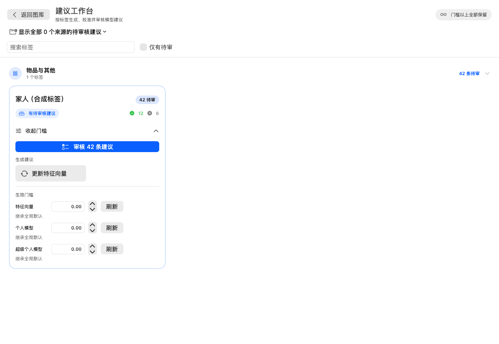

# 待审核建议交互改进 · 2026-09-09

本轮已实现项目所有者要求的卡片级交互，以及上一轮审核提出的全部六类改进；产品决定见 [ADR-073](../ADR-073-REVIEW-INTERACTION-CONTINUITY.md)。

## 用户可见变化

- 标签卡片整个摘要和卡片空白区域可展开门槛；摘要支持键盘操作，卡内审核、生成、更新和任务按钮独立响应，常用动作不再藏在门槛 disclosure 内。
- 总览支持搜索、仅有待审和生成中心显隐。筛选期间的分组折叠不修改用户的持久化分组偏好。
- 网格与单图共用固定审核操作栏，显示唯一照片数、属于、不属于、跳过、撤销和准确操作反馈；窄窗口可换行。
- 默认按照片合并已载入的多模型建议，可展开查看各模型原始分数，也可切回按模型逐条查看。服务器分页、顺序和原始条数保持独立。
- U 明确为不写决定的“跳过”，末尾先续载再前进；决定操作有并发门禁，避免重复提交。
- 撤销以当前待审结果验证恢复项目，保留已载入窗口并恢复主选择/可见锚点；模型更新时不伪造旧建议。
- 区分载入中、读取失败、来源未选、样本不足和当前无建议；失败提供重试，来源切换清除旧范围选区。

## 验证

- Mac `build-for-testing` 通过；SYMROOT、OBJROOT、CONFIGURATION_BUILD_DIR 均显式指定到 `/tmp/ImageAll-Review-20260909`，不启动 App。首轮只设置 DerivedData 时发现全局构建目录覆盖，已改用三个显式目录重新完成构建。
- 直接 XCTest bundle：16 项定向回归通过，0 失败。包含合并/按模型导航、跨页跳过、批量决定、原位撤销、失败恢复、来源过滤、网格导航以及合成界面渲染。
- 原生界面截图来自 NSHostingView + 空 Fake 目录和虚构标签，非日常 App；未做真实图库或日常窗口指针验收。
- Web 独立工作区：typecheck、lint、build 和 37 项单元测试通过；Chromium 桌面与移动审核场景共 30 项通过，包含真实指针点击卡片边缘、键盘展开、内部按钮独立性、跨页失败恢复、快速重复按键和无障碍检查。
- 两个工作区 `git diff --check` 通过。未 push、未启动或替换日常 App、未连接或读取真实照片。Web 源码及打包资源仅保留在 `ImageAll-Web-Dev`。

## 合成界面

截图显示更新按钮直接可见、门槛只有一层展开、整块摘要承载展开动作。数量和来源为合成 fixture，不代表真实图库。
